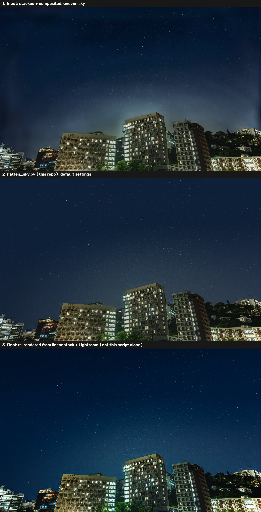

# sky-gradient-flatten

[English](README.md) | **简体中文**

把**星空＋地景**照片（城市、校园、风光星野）里不均匀的天空背景匀开——光污染光晕、堆栈接缝、边缘亮暗带、色斑——**建筑一个像素都不动**。

Siril 去背景、GraXpert 这类通用工具是为纯深空画面设计的。画面里有建筑时，地平线附近要么采不到样，要么在楼顶留下暗圈和光晕。这个脚本用你提供的地景蒙版，只拿天空像素建背景模型，地景像素按原值逐个写回。



*香港中文大学校园，约 8 级光污染，150 × 4 秒堆栈。**1** 输入：堆栈并合成后，光污染光晕明显不均。**2** `flatten_sky.py` 默认参数处理，建筑像素与输入完全相同。**3** 作者的最终成片，仅作参考：天空从线性堆栈重新渲染（星点颜色校准、保护银河的背景模型），再在 Lightroom 里调整。第 3 栏**不是**单靠本脚本得到的。*

## 能修什么

- 地平线附近的光污染光罩和偏色（可选保留一层柔和的自然渐亮）
- 画面边缘、四角的暗带和亮带
- 多张堆栈留下的锐边接缝和台阶（各帧覆盖范围不同）
- 天空里大块的色斑

**不做**：降噪、星点增强、换天。不会生成或删除星点。

## 安装

Python 3.9+：

```bash
pip install -r requirements.txt
```

或用 [uv](https://github.com/astral-sh/uv) 免安装：

```bash
uv run --with tifffile,numpy,scipy,opencv-python-headless python flatten_sky.py ...
```

## 用法

```bash
python flatten_sky.py photo.tif photo_flat.tif --mask foreground_mask.tif
```

- **输入**：8 位或 16 位 sRGB 的 RGB TIFF（Lightroom / Photoshop / Siril 导出都行）。ICC 配置文件会原样带到输出。
- **蒙版**：灰度 TIFF，尺寸与照片相同。**白 = 地景（建筑、树），黑 = 天空**，边缘可以是羽化的。如果你的蒙版正好反过来，加 `--invert-mask`。
- **输出**：一个新 TIFF，外加 `_compare.jpg`（上为处理前、下为处理后）、`_bgmodel.jpg`（拟合出的背景）和 `_log.json`（参数、前后匀度、各项校验）。不会覆盖输入文件。

### 蒙版和照片不是同一画布

如果蒙版是在未裁切的原图上做的，之后又在 Lightroom 里裁过，用 `--ref` 传入未裁切的原图，脚本会自动求出裁切偏移（只支持纯平移裁切）。也可以用 `--offset DY DX` 手动指定。

```bash
python flatten_sky.py cropped.tif out.tif --mask mask_full.tif --ref full.tif
```

### 怎么做蒙版

什么工具都可以：Photoshop「选择天空」→ 反选 → 黑底填白；Lightroom 的「选择天空」蒙版导出成图；GIMP；或者自己做分割。地景范围宁可比屋顶线多出几个像素，也不要贴得太紧。

## 主要参数

| 参数 | 默认 | 含义 |
|---|---|---|
| `--keep-glow` | 0.5 | 保留多少平滑的地平线光晕。`0` = 完全拉平（可能显得死板，并让原光晕区的噪点纹理露出来）。 |
| `--glow-sigma` | 400 | 保留光晕的平滑尺度，像素。 |
| `--sigma` | 250 | 主背景模型的尺度，像素。越小越能修小斑块，但**也可能把银河这类真实结构减掉**——画面有银河时调大（如 600 以上）。 |
| `--fine-sigma` | 80 | 小尺度残差修正，像素（`0` = 关闭）。修正屋顶线正上方的过度或不足。 |
| `--seam` | 100 | 去堆栈接缝的保边中值窗口，像素（`0` = 关闭）。有银河时也建议调小或关闭。 |
| `--strength` | 1.0 | 整体强度，`0`–`1`。 |
| `--target-pct` | 50 | 目标天空亮度 = 拟合背景的这个百分位。 |

全部参数见 `python flatten_sky.py -h`。

## 原理

光污染是加性的，所以校正在**线性光**下进行（先去掉 sRGB 曲线）：

1. 在 1/4 尺度用中值滤波去星；只剔除*小尺寸*的亮异常（亮星、飞机），宽的光带留在样本里，才能被校正掉。
2. 只用天空像素，以**局部线性的掩膜归一化卷积**建背景模型。普通的掩膜模糊会被离地平线更远、更暗的天空拉低，导致楼顶附近的光晕校正不足；线性项能把梯度一直跟到蒙版边缘。
3. 目标场 = 常数天空色 + 可选的一部分极平滑地平线光晕。
4. 两道细修：小尺度残差修正，以及去锐边堆栈接缝的**保边中值**修正（中值会把台阶保留为台阶，减掉它台阶就消了）。
5. 按蒙版混合后转回 sRGB；蒙版 = 1 的像素直接从输入原样复制。

## 提示与局限

- 已调色的导出图也能用，但效果最好的是轻度处理的图：先匀背景，再到 Lightroom 里调对比和颜色。
- 蒙版质量最关键。已经烤进图里的屋顶线亮边（比如合成留下的）不会被去掉。
- 2400 万像素全分辨率，在 Apple Silicon 笔记本上约 20 秒，需要几 GB 内存。
- 使用前看一下 `_compare.jpg`，并在 100% 下检查屋顶线附近。

## 许可证

MIT
